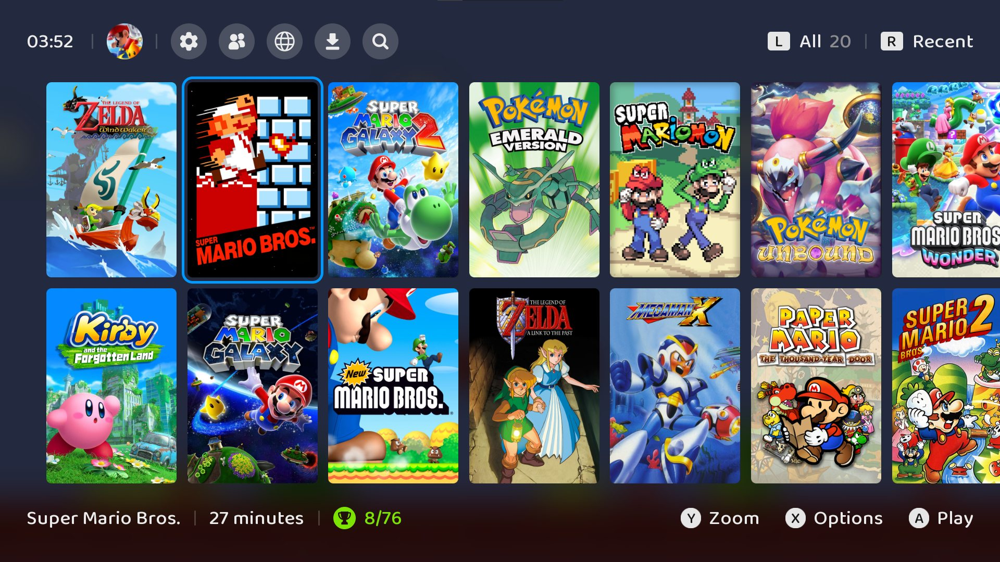

# Bomba GUI

**⚠️ WARNING - This project was vibe coded with a dash of extra slop.**
**Courtesy of Claude Opus 5.5. ⚠️**

A modern console-style GUI for RetroArch. Designed for ease of use and fitted
with extra tools, including [Eden](https://eden-emu.dev/) integration. Made
for me, myself, and I.



## Launching without Steam

1. Download the latest `bomba-gui-vX.Y.Z.zip` from
   [Releases](https://github.com/Slazmaz/RetroArch-Bomba-GUI/releases/latest)
   and unzip it into a folder of its own, e.g. `C:\Bomba GUI`.
2. Run `bomba.exe`.

## Launching with Steam

Launching with steam integrates steam multiplayer, overlay, and cloud saves.

1. Install [RetroArch](https://store.steampowered.com/app/1118310/RetroArch/)
   from Steam.
2. Download the latest `bomba-gui-vX.Y.Z.zip` from
   [Releases](https://github.com/Slazmaz/RetroArch-Bomba-GUI/releases/latest)
   and unzip it into a folder of its own, e.g. `C:\Bomba GUI`.
3. In Steam, right-click RetroArch → **Properties** → **General**, and set
   **Launch Options** to the path of `bomba.exe` followed by `%command%`:

   ```
   "C:\Bomba GUI\bomba.exe" %command%
   ```

4. Play RetroArch from Steam.

To play multiplayer, start Retroarch from Steam. Next to your profile icon
there will be an **Invite Friends** button; simply open that menu and select
the friends you want to invite. Once they accept, games will see them as a
LAN player. Only works with Eden for now.

## Updating

You can easily stay up to date by launching Bomba GUI and opening the **Downloads**
menu. There you can update Bomba GUI itself, and update or install cores.

## License

GPLv3, like RetroArch. Baloo 2 is under the SIL Open Font License, and the
mist headers are under MPL-2.0 (see their folders). The icons in
`bomba/icons` are from [Flaticon](https://www.flaticon.com), under the
Flaticon license; see [their credits](../bomba/icons/CREDITS.md). The menu
sounds in `bomba/sounds` are by ViRiX Dreamcore, under CC BY-NC 3.0.
